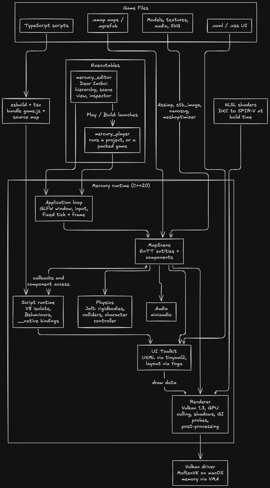

# Mercury

Mercury is a game-engine built with C++ for performant games


## Table of Contents

- [Mercury](#mercury)
  - [Table of Contents](#table-of-contents)
  - [Goal](#goal)
  - [Support](#support)
  - [Architecture](#architecture)
  - [Building](#building)
    - [macOS (Apple Silicon)](#macos-apple-silicon)
    - [Linux (X11 and Wayland)](#linux-x11-and-wayland)
    - [Windows](#windows)
  - [Issues](#issues)
  - [Contributing](#contributing)
  - [Documentation](#documentation)
  - [License](#license)

## Goal

A completely open-source program that is designed to be develop performant video-games. The primary goal
is to develop simulator video-games like Railroad Tycoon, SimCity, Cities Skylines etc. This means that it
is developed specifically for top-down games with lots of systems being simulated, and features like ray-tracing,
or advanced graphics might never be supported.

## Support

A goal of this project was to be cross-platform. Since everything is being implemented
myself it is difficult to and thus I'm only aiming for desktop platforms with a limited number
of graphics backends.

The order of the platform is the order of importance for compatibility.
For example, Windows has the most support and hence is the first on the list.
If a platform is not on the list then that means supporting is not a goal of this project.

| Platform      | Renderer | Support |
|---------------|----------|---------|
| Windows 10/11 | Vulkan   | Yes     |
| Linux         | Vulkan   | Yes     |
| MacOS         | MoltenVK | Yes     |
| SteamOS       | Vulkan   | No [^1] |


Rendering requires a GPU and driver with Vulkan 1.3 (dynamic rendering). Shaders are
written in HLSL and compiled to SPIR-V with DXC at build time.

[^1]: The goal is to have SteamOS specific features like support for those touchpads on the
SteamDeck or the controllers. Along with support for controller layouts, battery modes and more.

## Architecture

A game is a project (`.mproj`) of maps (`.mmap`), assets, UI documents and TypeScript scripts. The
player (or the editor's Play button) loads a map into an EnTT scene and runs a fixed-step tick plus a
per-frame render. Scripts run in an embedded V8; everything native (physics, audio, rendering) sits
behind the engine, and scripts reach it only through a small checked `__native` API.



| Layer | Dependency | Used for |
|---|---|---|
| Scripting | [V8](https://v8.dev), [esbuild](https://esbuild.github.io) | Run TypeScript game scripts; bundle them with source maps |
| Scene | [EnTT](https://github.com/skypjack/entt), [GLM](https://github.com/g-truc/glm) | Entity-component storage, math |
| Physics | [Jolt Physics](https://github.com/jrouwe/JoltPhysics) | Rigid bodies, colliders, character controller |
| Rendering | Vulkan 1.3, [VMA](https://github.com/GPUOpen-LibrariesAndPlugins/VulkanMemoryAllocator), [DXC](https://github.com/microsoft/DirectXShaderCompiler), [GLFW](https://www.glfw.org) | Drawing, GPU memory, HLSL to SPIR-V, window and input |
| Assets | [Assimp](https://github.com/assimp/assimp), [stb](https://github.com/nothings/stb), [nanosvg](https://github.com/memononen/nanosvg), [meshoptimizer](https://github.com/zeux/meshoptimizer) | Models, images, SVG, mesh simplification |
| UI | [Yoga](https://github.com/facebook/yoga), [tinyxml2](https://github.com/leethomason/tinyxml2) | Flexbox layout, UXML parsing |
| Audio | [miniaudio](https://miniaud.io) | Playback with 3D attenuation |
| Editor | [Dear ImGui](https://github.com/ocornut/imgui) | Editor panels (also debug overlays) |
| Build | [Bazel](https://bazel.build) | Builds everything, runs the tests |

## Building

Game scripts are TypeScript, run by an embedded V8. V8 is fetched once with depot_tools and is
built by Bazel from V8's own Bazel files. esbuild bundles the scripts.

The build requires [Bazelisk](https://github.com/bazelbuild/bazelisk); the repository pins Bazel
in `.bazelversion`. CMake and Ninja are still used, but only to build the third-party dependencies
through `rules_foreign_cc`.

### macOS (Apple Silicon)

```sh
./scripts/setup_project.pl              # detects macOS; Homebrew: Bazelisk, CMake, Ninja, MoltenVK, Vulkan, DXC
bazelisk build //mercury:mercury_player
bazelisk test //tests/...
bazelisk run //mercury:mercury_player -- examples/pong/pong.mproj
```

V8's first Bazel build takes 30-60 minutes. If V8's Bazel build cannot be used on your Xcode/host
combination, build the GN fallback once and select it:

```sh
./scripts/build_v8.pl
bazelisk build //mercury:mercury_player --define=v8_backend=gn
```

### Linux (X11 and Wayland)

```sh
./scripts/setup_project.pl              # detects Linux; apt or pacman: Vulkan, GLFW deps, DXC, esbuild, Bazelisk
bazelisk build //mercury:mercury_player
bazelisk test //tests/...
bazelisk run //mercury:mercury_player -- examples/pong/pong.mproj
```

`scripts/fetch_v8.pl` (see `third_party/v8/README.md`) fetches the version in
`third_party/v8/VERSION`. Node and `typescript` are optional: when `tsc` is installed, Build also
type-checks the scripts.

Debian/Ubuntu don't package DXC, so the setup script downloads the official release into
`bin/dxc/`. If you use the [LunarG Vulkan SDK](https://vulkan.lunarg.com) instead, set
`VULKAN_SDK` and its `dxc` is used.

Debug builds enable `VK_LAYER_KHRONOS_validation` when it is installed.

### Windows

Windows is not currently supported. The setup scripts print `OS not supported` and exit.

## Issues

Any bugs related to the game engine can be reported to my email: [smadhur@reocelot.com](mailto:smadhur@reocelot.com)

## Contributing

Mercury is open-source but not open-contribution. Features part of this engine
are specifically for games **I** want to make and not to be generalized.
In fact there are much better engines already out there that do most things
better so I'd recommend using that if you cannot find a feature here.

That being said, there are many instances where you might want a change urgently (bugs, vulnerabilities)
and perhaps already fixed it, in which case email [smadhur@reocelot.com](mailto:smadhur@reocelot.com) with
more information or with
a [git patch](https://git-scm.com/book/en/v2/Distributed-Git-Contributing-to-a-Project#_project_over_email).

Official repositories for the code:

- https://git.smadhur.dev/mercury-engine.git [main]
- https://github.com/siddhantmadhur/mercury-engine [mirror]

## Documentation

How the engine works (application structure, projects and the editor, file formats, components,
rendering and lighting, scripting, UI Toolkit, shipping and testing) is in
[DOCUMENTATION.md](DOCUMENTATION.md). Planned work is in [GOAL.md](GOAL.md).

## License

[GNU GPLv3](/LICENSE)
