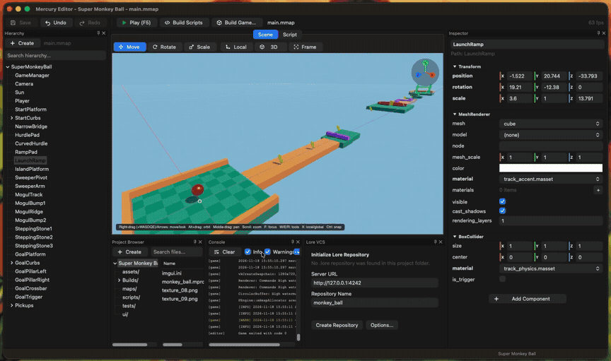
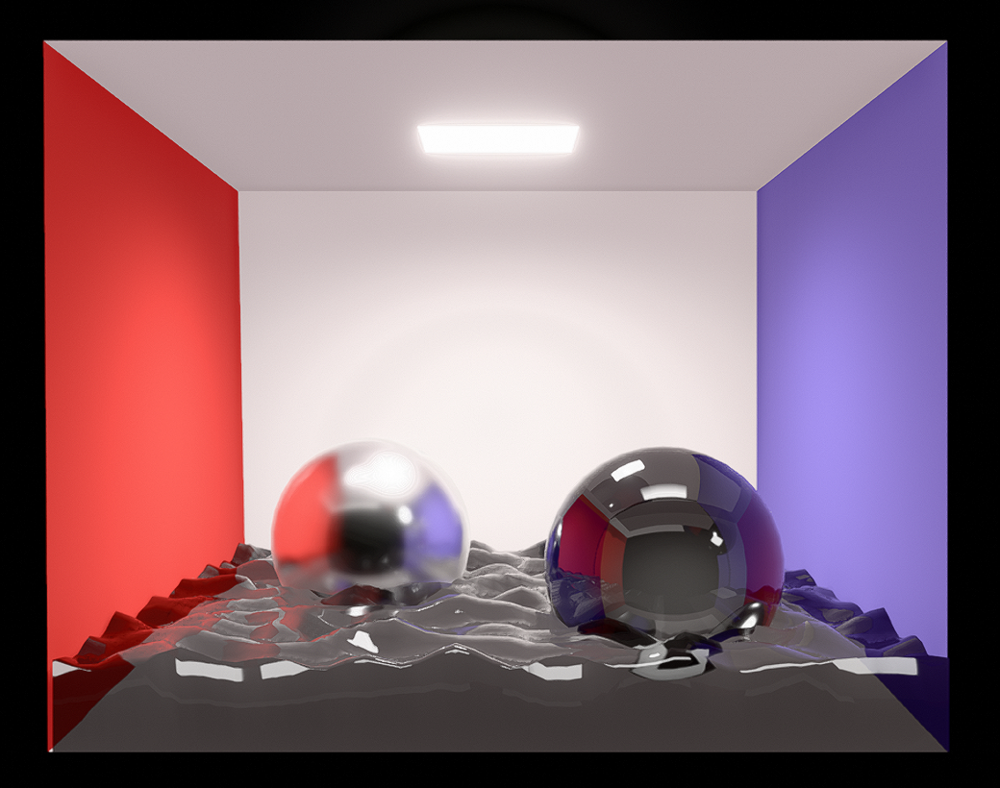
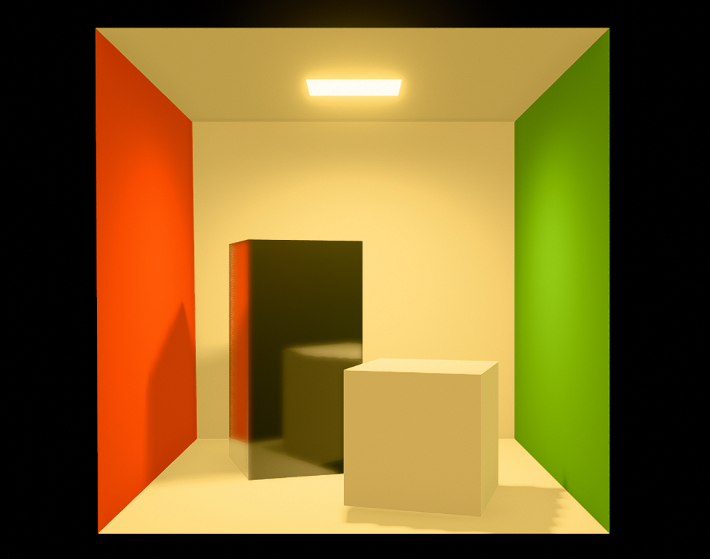
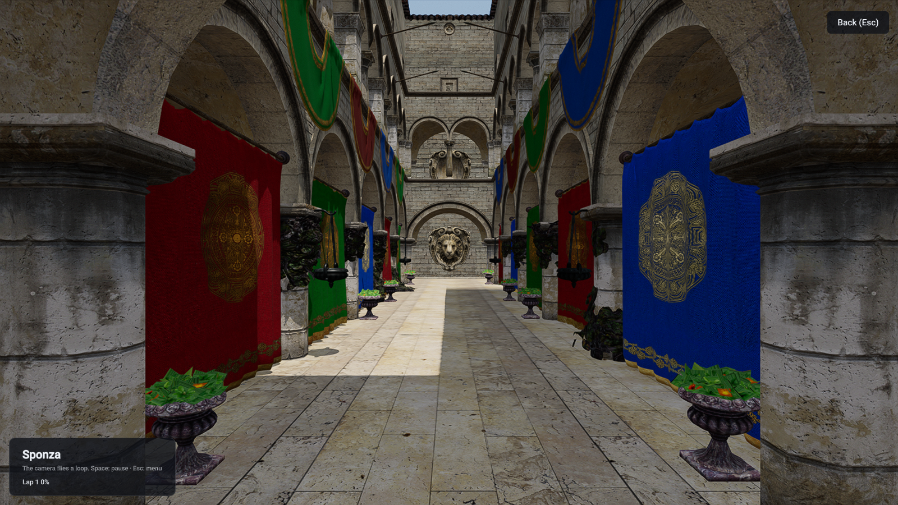
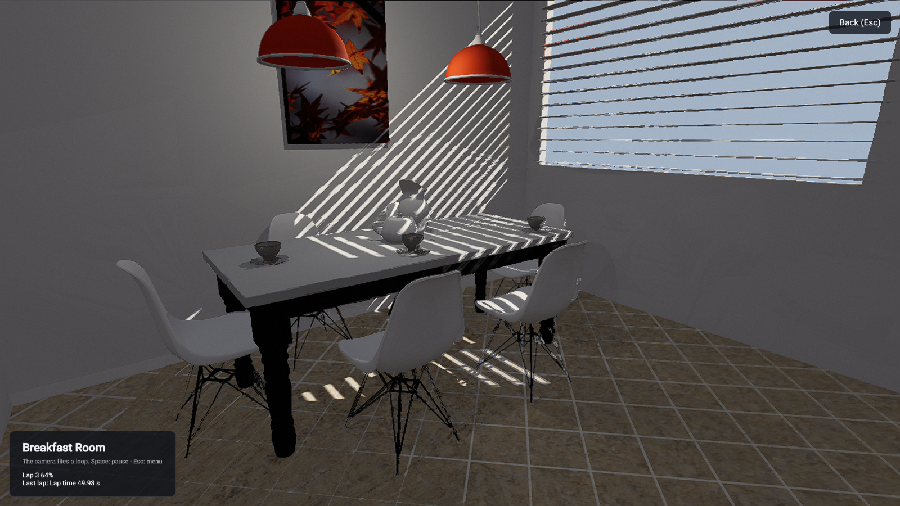

# Mercury

Mercury is a game-engine built with C++ for performant games



## Table of Contents

- [Mercury](#mercury)
  - [Table of Contents](#table-of-contents)
  - [Showcase](#showcase)
  - [Goal](#goal)
  - [Support](#support)
  - [Architecture](#architecture)
  - [Building](#building)
    - [macOS (Apple Silicon)](#macos-apple-silicon)
    - [Linux (X11 and Wayland)](#linux-x11-and-wayland)
    - [Windows](#windows)
  - [Issues](#issues)
  - [Contributing](#contributing)
  - [Documentation](#documentation)
  - [License](#license)

## Showcase

Rendered in Mercury's Vulkan/[Filament](https://github.com/google/filament) backend with PBR materials, multi-bounce room-capture light probes, area and directional lights, shadows, and post-processing:

<table>
  <tr>
    <td align="center" width="50%">
      <br>
      <sub><b>Cornell Box — Water &amp; Reflections</b>: Rippled water, metallic and transmissive spheres, area light bloom, and room-capture light probes</sub>
    </td>
    <td align="center" width="50%">
      <br>
      <sub><b>Cornell Box — Mirror &amp; Area Light</b>: Specular reflections, warm area lighting, soft shadows, and indirect color bounce</sub>
    </td>
  </tr>
  <tr>
    <td align="center" width="50%">
      <br>
      <sub><b>Crytek Sponza</b>: Directional sunlight, shadowed arcades, and indirect ambient fill</sub>
    </td>
    <td align="center" width="50%">
      <br>
      <sub><b>Breakfast Room</b>: Slatted directional shadows, point lighting, and interior bounce</sub>
    </td>
  </tr>
</table>

## Goal

A completely open-source program that is designed to be develop performant video-games. The primary goal
is to develop simulator video-games like Railroad Tycoon, SimCity, Cities Skylines etc. This means that it
is developed specifically for top-down games with lots of systems being simulated, and features like ray-tracing,
or advanced graphics might never be supported.

## Support

A goal of this project was to be cross-platform. Since everything is being implemented
myself it is difficult to and thus I'm only aiming for desktop platforms with a limited number
of graphics backends.

The order of the platform is the order of importance for compatibility.
For example, Windows has the most support and hence is the first on the list.
If a platform is not on the list then that means supporting is not a goal of this project.

| Platform      | Renderer | Support |
|---------------|----------|---------|
| Windows 10/11 | Vulkan   | Yes     |
| Linux         | Vulkan   | Yes     |
| MacOS         | MoltenVK | Yes     |
| SteamOS       | Vulkan   | No [^1] |


Rendering requires a GPU and driver with Vulkan 1.3 (dynamic rendering). Shaders are
authored as [Filament](https://github.com/google/filament) materials and
compiled with `matc` at build time.

[^1]: The goal is to have SteamOS specific features like support for those touchpads on the
SteamDeck or the controllers. Along with support for controller layouts, battery modes and more.

## Architecture

A game is a project (`.mproj`) of maps (`.mmap`), assets, UI documents and scripts. Gameplay can be
written in [AngelScript](https://www.angelcode.com/angelscript/) (`.as`, compiled in-process) or C++
(linked into a per-project executable). The player (or the editor's Play button) loads a map into an
EnTT scene and runs a fixed-step tick plus a per-frame render. Everything native (physics, audio,
rendering) sits behind the engine, and scripts reach it only through a small checked native API.


| Layer | Dependency | Used for |
|---|---|---|
| Scripting | [AngelScript](https://www.angelcode.com/angelscript/), C++ | Compile and run `.as` scripts, or link C++ `MERCURY_SCRIPT` components |
| Scene | [EnTT](https://github.com/skypjack/entt), [GLM](https://github.com/g-truc/glm) | Entity-component storage, math |
| Physics | [Jolt Physics](https://github.com/jrouwe/JoltPhysics) | Rigid bodies, colliders, character controller |
| Rendering | [Filament](https://github.com/google/filament) (Vulkan), [GLFW](https://www.glfw.org) | Drawing, lighting, shadows, post-processing, window and input |
| Assets | [Assimp](https://github.com/assimp/assimp), [stb](https://github.com/nothings/stb), [nanosvg](https://github.com/memononen/nanosvg), [meshoptimizer](https://github.com/zeux/meshoptimizer) | Models, images, SVG, mesh simplification |
| UI | [Yoga](https://github.com/facebook/yoga), [tinyxml2](https://github.com/leethomason/tinyxml2) | Flexbox layout, UXML parsing |
| Audio | [miniaudio](https://miniaud.io) | Playback with 3D attenuation |
| Editor | [wxWidgets](https://www.wxwidgets.org) (wxAUI, wxStyledTextCtrl), [Dear ImGui](https://github.com/ocornut/imgui) | Editor panels and code editor; Dear ImGui for debug overlays |
| Build | [CMake](https://cmake.org) + [Ninja](https://ninja-build.org) | Builds everything, runs the tests; ccache caches compiles |

## Building

Game scripts are AngelScript (`.as`) or C++ (`scripts/*.cc` linked into the game executable).
AngelScript is a C++ library built directly by CMake from the pinned
`third_party/angelscript` submodule; there is no external code generation or bundler.

The build uses CMake with Ninja. `ccache` (installed by the setup script) caches compiler
output, so rebuilding after a branch switch or in a second build directory is fast.
Rust modules are built by Cargo from the `Cargo.toml` workspace; CMake runs `cxxbridge` to
generate their C++ bridge code, and both `cargo` and `cxxbridge` are installed by the setup
script. The editor's built-in code editor uses `wxStyledTextCtrl`, so the system wxWidgets
installation must provide the `stc` library (`wx-config --libs ...,stc`).

Build directories live in `build/<preset>/` and are ignored by git. `cmake --build` builds
the player, editor, examples and compiled materials; tests are built and run by the `check`
target (`cmake --build --preset check`). Use `cmake --preset debug` (or `relwithdebinfo`)
for a different configuration; all presets share the same ccache.

### macOS (Apple Silicon)

Mercury requires macOS 26.0 or later; builds are stamped with that deployment
target so the packaged `.app` runs on any macOS 26 release. See
`CMAKE_OSX_DEPLOYMENT_TARGET` in `CMakeLists.txt`.

```sh
./scripts/setup_project.pl              # detects macOS; Homebrew: CMake, Ninja, ccache, Rust, MoltenVK, Vulkan, DXC
cmake --preset release
cmake --build --preset release
cmake --build --preset check            # build and run the tests
./build/release/bin/mercury_player examples/pong/pong.mproj
# C++ gameplay example (its own executable)
./build/release/bin/cpp_hello
```

To ship a game as a self-contained `.app` bundle:

```sh
./scripts/package_macos.pl --project examples/pong/pong.mproj
open Builds/Pong.app
```

The bundle carries the player, MoltenVK, the Vulkan loader and the project's `.mpack`
archives; it does not read anything from this checkout. See
[Shipping a game](DOCUMENTATION.md#shipping-a-game).

To publish the editor itself (Play and Build Game work without this checkout):

```sh
./scripts/package_macos.pl --target editor --name "Mercury Editor" --zip
```

### Linux (X11 and Wayland)

```sh
./scripts/setup_project.pl              # detects Linux; apt or pacman: Vulkan, GLFW deps, DXC, CMake, Ninja, ccache, Rust
cmake --preset release
cmake --build --preset release
cmake --build --preset check            # build and run the tests
./build/release/bin/mercury_player examples/pong/pong.mproj
# C++ gameplay example (its own executable)
./build/release/bin/cpp_hello
```

Debian/Ubuntu don't package DXC, so the setup script downloads the official release into
`bin/dxc/`. If you use the [LunarG Vulkan SDK](https://vulkan.lunarg.com) instead, set
`VULKAN_SDK` and its `dxc` is used.

Debug builds enable `VK_LAYER_KHRONOS_validation` when it is installed.

### Windows

Windows is not currently supported. The setup scripts print `OS not supported` and exit.

## Issues

Any bugs related to the game engine can be reported to my email: [smadhur@reocelot.com](mailto:smadhur@reocelot.com)

## Contributing

Mercury is open-source but not open-contribution. Features part of this engine
are specifically for games **I** want to make and not to be generalized.
In fact there are much better engines already out there that do most things
better so I'd recommend using that if you cannot find a feature here.

That being said, there are many instances where you might want a change urgently (bugs, vulnerabilities)
and perhaps already fixed it, in which case email [smadhur@reocelot.com](mailto:smadhur@reocelot.com) with
more information or with
a [git patch](https://git-scm.com/book/en/v2/Distributed-Git-Contributing-to-a-Project#_project_over_email).

Official repositories for the code:

- https://git.smadhur.dev/mercury-engine.git [main]
- https://github.com/siddhantmadhur/mercury-engine [mirror]

## Documentation

How the engine works (application structure, projects and the editor, file formats, components,
rendering and lighting, scripting, UI Toolkit, shipping and testing) is in
[DOCUMENTATION.md](DOCUMENTATION.md). Planned work is in [GOAL.md](GOAL.md).

The API reference and beginner guides are generated with Doxygen from the
headers, the editor and `docs/`:

```sh
doxygen Doxyfile
open docs/doxygen/html/index.html   # macOS; use a browser elsewhere
```

The output in `docs/doxygen/` is generated and is not committed.

## License

[MPL 2.0](/LICENSE)
